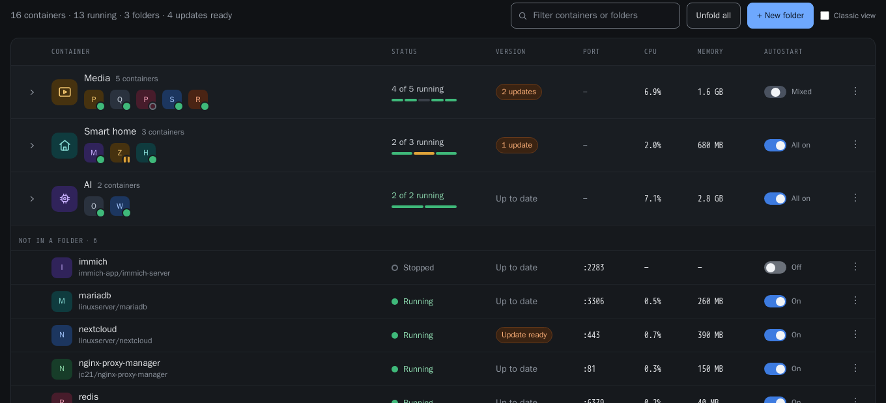
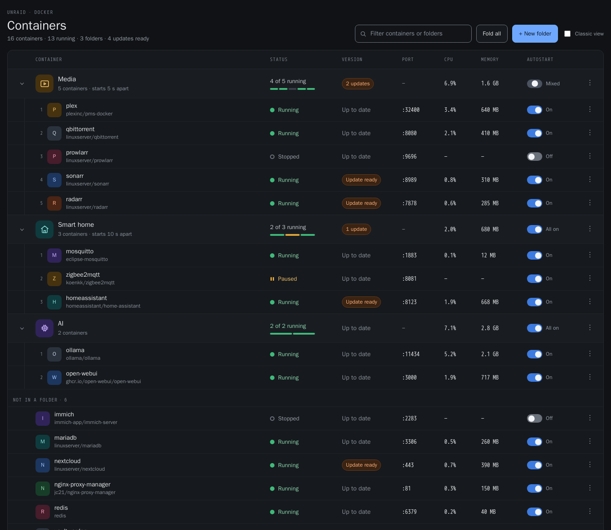

# Simple Folders

Group Docker containers into folders on the Unraid Docker page.

Fold a folder away behind a single row that still shows every member's icon,
unfold it to see the full container rows in start order, and run start, stop,
restart, pause, resume, update or force update across a whole folder — one
container at a time, in the order you chose.

Supports **Unraid 7.2 – 7.4**.



---

## What it does

- **Folders on the Docker page.** A folded folder shows its name, its member
  count and an icon strip with *every* member — no cap, no "+3". Clicking any
  of those icons opens that container's own menu. Unfold to get the full rows,
  numbered in start order.
- **Folder-wide commands** from the folder's icon or its ⋮ menu: start, stop,
  restart, pause/resume, check for updates, update, force update, open every
  WebUI. They run sequentially, honouring the folder's delay between starts
  and reverse-order stop. Only one job runs at a time.
- **Folders that fill themselves.** Give a folder a name pattern, or label a
  container `simple.folders=<folder>`, and matching containers join
  automatically — including containers created later.
- **Start order that actually applies at boot.** A folder's order and delay are
  written into Unraid's own `/var/lib/docker/unraid-autostart`, so the array
  starts containers in the same order the folder uses. No second, competing
  order to keep in sync.
- **Folder icons** from a built-in set, from one of the member containers, or
  searched across Dashboard Icons and selfh.st — both libraries' published
  indexes, so results are real files rather than guessed names — and stored
  locally so they still render with no internet.
- **Drag to rearrange.** Grab a row anywhere — its name, its icon, or the grip
  at the left: reorder a container that is in no folder (this writes Unraid's
  own display order, so the stock table agrees), drag one onto
  a folder to move it there, between two members to set where it starts in the
  folder, or down to "Not in a folder" to take it out. Drag a folder to reorder
  the folders. Pointer Events, so touch works as well as a mouse — and every
  one of those moves is also in the menus and the editor, which is what
  keyboard users have.
- **The classic Docker actions** at the foot of the table: add a container,
  start/stop/pause/resume everything, check for and apply updates, container
  size. Stop and Pause confirm first.
- **Classic view.** One switch puts Unraid's standard table back, untouched.



Editing or deleting a folder **never** stops, removes or recreates a
container. Deleting one only removes the grouping; its containers keep running
and move to "Not in a folder".

---

## Install

**Community Applications** — search for *Simple Folders*.

**Manually** — Plugins → Install Plugin, and paste:

```
https://raw.githubusercontent.com/gcarstoiu/simple.folders/main/simple.folders.plg
```

Then open the **Docker** tab.

### Uninstalling

Removing the plugin restores the stock Docker page and touches no container.
Folder definitions stay in `/boot/config/plugins/simple.folders/` so a
reinstall picks them up; delete that directory to erase them.

---

## How it fits into Unraid

The plugin adds a page file with `Menu="Docker"`, which emhttp renders inside
the Docker tab after the stock container table. **No core file is patched.**

It reads containers through Unraid's own `DockerClient` / `DockerTemplates`
classes and acts through Unraid's own endpoints:

| What | Unraid's own code we call |
|---|---|
| start / stop / restart / pause / resume | `dynamix.docker.manager/include/Events.php` |
| check for updates | `include/DockerUpdate.php` |
| update and force update | `scripts/update_container` |
| autostart flag and start delay | `include/UpdateConfig.php` |
| live CPU and memory | the `dockerload` nchan channel |

It deliberately does **not** parse the HTML that `include/DockerContainers.php`
renders. That markup changed substantially between 7.2.1 and 7.4, and scraping
it is the usual reason folder plugins break on an Unraid upgrade. The
endpoints above were verified byte-identical across that same range.

Update and force update are the same operation — `update_container` always
pulls and recreates, restoring each container's previous running state. The
two menu items differ only in which containers they target.

### Where things live

| Path | What |
|---|---|
| `/boot/config/plugins/simple.folders/folders.json` | folder definitions (flash, survives reboots) |
| `/boot/config/plugins/simple.folders/icons/` | downloaded folder icons |
| `/usr/local/emhttp/plugins/simple.folders/` | the plugin itself (RAM; rebuilt each boot) |
| browser `localStorage` | which folders *you* have open, and Classic view |

Fold state is per-viewer on purpose, so two people looking at the same server
do not fight over each other's open folders.

---

## Development

No build step — the plugin is plain PHP, CSS and ES5-compatible JavaScript
that runs as-is from `src/`.

### Local harness

`harness/` is a mock Unraid: stub implementations of every endpoint the plugin
calls, 16 fake containers matching the design, a fake `dockerload` stream, and
a faithful copy of Unraid's global CSRF gate — so code that forgets the token
fails locally instead of on your server.

```bash
./harness/serve.sh          # http://localhost:8089
```

It uses a local `php` if there is one, otherwise `php:8.3-cli-alpine` in
Docker (matching the PHP that Unraid 7.2–7.4 ship).

| Variable | Effect |
|---|---|
| `HARNESS_LATENCY` | seconds per simulated docker action (default `0.6`, `0` = instant) |
| `HARNESS_FAIL` | force failures, e.g. `sonarr:stop,radarr:*` |

Useful URLs: `?theme=white｜black｜azure｜gray`, `?folded=all`,
`?nostream=1` (stop the live stream so a headless browser can settle),
`/_reset` (wipe state).

### Tests

```bash
./harness/serve.sh &
./harness/test/run.sh          # all
./harness/test/run.sh filter   # just the matching ones
python3 tools/contrast.py      # WCAG check on both token sets
```

`run.sh` walks `design/DESIGN_SPEC.md` §15's acceptance checklist with real
clicks and keystrokes, driving a headless Chrome over CDP, and writes a
screenshot per state to `harness/test/shots/`.

### Packaging

```bash
./pkg_build.sh      # -> archive/simple.folders-<version>.txz, md5 into the .plg
```

Bump the version in one place: the `<!ENTITY version>` line in
`simple.folders.plg`.

### Design

`design/` holds the handoff this was built from — `DESIGN_SPEC.md` is the
source of truth for behaviour, with the prototype and screenshots beside it.

Known deviations, all deliberate:

- **Fonts.** The spec asks for IBM Plex Sans/Mono. Shipping a webfont into
  someone else's UI is the wrong trade, so the host theme's face is inherited
  and only the sans/mono distinction is kept.
- **Control contrast.** The handed-over tokens put the control border and the
  switch "off" track at about 1.4:1 against their backgrounds, below WCAG
  1.4.11's 3:1 for control boundaries. Both were darkened/lightened until they
  pass; `tools/contrast.py` enforces it.
- **Light themes.** The tokens were dark-only. `styles/tokens.css` derives a
  light set for Unraid's `white` and `azure` themes.
- **Update progress.** Phases come from polling the server, not from parsing
  `update_container`'s log — that log is translated on non-English servers.

---

## Licence

GPL-2.0. See [LICENSE](LICENSE).

The plugin interoperates with, and calls into, Unraid's GPL-2.0 Docker manager.

**It bundles no third-party artwork.** Container icons come from Unraid's own
resolution. Folder icons are either the built-in glyph set (original to this
project), a container's own icon, or a file the user chooses to download.

Icon search reads, and downloads on the user's request, from two libraries:

| Library | Licence |
|---|---|
| [Dashboard Icons](https://github.com/homarr-labs/dashboard-icons) | Apache-2.0 |
| [selfh.st/icons](https://selfh.st/icons/) | CC BY 4.0 |

Both permit redistribution; CC BY 4.0 requires attribution, which is given
here, in Settings → Simple Folders, and beside the search itself. Individual
logos remain the property of their respective owners — neither the libraries'
licences nor this one grant any trademark rights.
